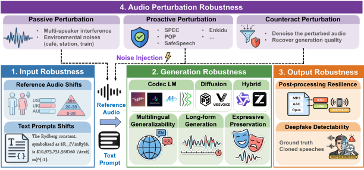

<div align="center">


# RVCBench

### Comprehensive Voice Cloning Evaluation

[](https://arxiv.org/abs/2602.00443)
[](https://arxiv.org/abs/2602.00443)
[](https://pypi.org/project/rvcbench/)
[](https://huggingface.co/datasets/Nanboy/RVCBench)
[](https://github.com/Nanboy-Ronan/RVCBench/actions/workflows/ci.yml)

[**Paper**](https://arxiv.org/abs/2602.00443) · [**Dataset**](https://huggingface.co/datasets/Nanboy/RVCBench) · [**Documentation**](https://nanboy-ronan.github.io/RVCBench/docs/) · [**Website & results**](https://nanboy-ronan.github.io/RVCBench/) · [**Audio demo**](https://huggingface.co/spaces/Nanboy/RVCBench)

</div>

**RVCBench** (accepted at **NeurIPS 2026**) combines conventional voice-cloning utility evaluation
with tests across speakers, languages and real-world audio conditions.

- **Utility:** speaker similarity, content accuracy, speech quality, intelligibility and emotion consistency.
- **Robustness:** noisy or overlapping references, compression, anti-cloning protection, long-form speech,
  unusual text, speaker demographics and multilingual/cross-lingual coverage.
- **Automated evaluation:** a pip package with seven metrics, prompt export and evaluation reports.
  Use our datasets or score your own audio.

[](figs/main.svg)

## Install

Linux, Python 3.10–3.13 and FFmpeg are required. CPU and GPU scoring are supported.

```bash
python -m pip install "rvcbench[eval]"
rvcbench setup-scorers
```

`setup-scorers` downloads and verifies metric models once. For FFmpeg setup, CPU/GPU installation
and download requirements, see the [installation guide](https://nanboy-ronan.github.io/RVCBench/docs/installation/).

## Quick start

| Your goal | Start here |
| --- | --- |
| Score generated audio with your own reference data | [Score your own audio](#score-your-own-audio) |
| Test a model on RVCBench datasets | [Evaluate your model](#evaluate-your-model) |
| Reproduce the published experiments | [Reproduce the paper](#reproduce-the-paper) |

### Score your own audio

```python
from rvcbench import metrics

with metrics.Evaluator(["sim", "wer", "speechmos"], device="cpu") as evaluator:
    scores = evaluator.score(
        "generated.wav",
        reference="speaker_reference.wav",
        text="Hello there.",
        language="en",
    )
    print(scores)
```

Replace the audio paths and expected text with your own. Available metrics are `sim`, `sva`, `wer`,
`speechmos`, `mcd`, `stoi` and `emotion`. MCD/STOI also require a same-text target recording.
See the [metrics guide](https://nanboy-ronan.github.io/RVCBench/docs/metrics/) for inputs and batch scoring.

### Evaluate your model

Start with the **52-utterance onboarding suite**:

```bash
rvcbench prompts --suite onboarding-v1 --output prompts/
# Generate each prompt with your model; save outputs as <id>.wav in outputs/my-model/.
rvcbench score --suite onboarding-v1 --generated outputs/my-model --output results/my-model --device cpu
```

RVCBench prepares the data and scores your outputs; **you supply model inference**.
Prompt exports include JSONL, ZipVoice TSV and Seed-TTS-style batch lists.
The [step-by-step guide](https://nanboy-ronan.github.io/RVCBench/docs/quickstart/)
covers file formats, generation and reading the report.

For broader evaluation, use **core-v1 (480 utterances)** or **full-v1 (12,724 utterances)**.
See [suite coverage and task selection](https://nanboy-ronan.github.io/RVCBench/docs/core_suite/)
and [resume and model comparison](https://nanboy-ronan.github.io/RVCBench/docs/adding_a_model/).
**Packaged suites are currently previews and use a separate protocol from the paper.**
The paper's deepfake-detectability evaluation and audio-LLM expression judge are not included in these suites.

## Results

The paper defines **18 evaluations**, **14,370 utterances** and **204 speakers**.
Browse [interactive results and audio examples](https://nanboy-ronan.github.io/RVCBench/),
[paper result tables](docs/paper_results.md), or the [paper](https://arxiv.org/abs/2602.00443) for the full analysis.

## Reproduce the paper

The frozen [`v1` branch](https://github.com/Nanboy-Ronan/RVCBench/tree/v1) (tag `v1.0`)
contains the paper-release code. `main` contains the installable package for evaluating new models.
See [versions and reproduction](https://nanboy-ronan.github.io/RVCBench/docs/versions/).

## More documentation

- [Built-in models](https://nanboy-ronan.github.io/RVCBench/docs/models/) — 32 voice-cloning adapters, protection and denoising workflows.
- [Datasets](https://nanboy-ronan.github.io/RVCBench/docs/datasets/) — source corpora, Hub folders and preprocessing.
- [Python API](https://nanboy-ronan.github.io/RVCBench/docs/api/) · [CLI reference](https://nanboy-ronan.github.io/RVCBench/docs/cli/) · [Run records](https://nanboy-ronan.github.io/RVCBench/docs/run_protocol/).
- [Contributing](CONTRIBUTING.md) — development setup, checks and adding a model.

## Citation

```bibtex
@inproceedings{jin2026rvcbench,
  title     = {RVCBench: Benchmarking the Robustness of Voice Cloning Across Modern Audio Generation Models},
  author    = {Jin, Ruinan and Liao, Xinting and Yu, Hanlin and Pandya, Deval and Li, Xiaoxiao},
  booktitle = {Advances in Neural Information Processing Systems},
  url       = {https://arxiv.org/abs/2602.00443},
  year      = {2026}
}
```

## License & contact

[CC0-1.0](LICENSE). Models, upstream code and source corpora retain their own licenses.
Questions and contributions are welcome through [issues](https://github.com/Nanboy-Ronan/RVCBench/issues)
or **ruinanjin@alumni.ubc.ca**.
